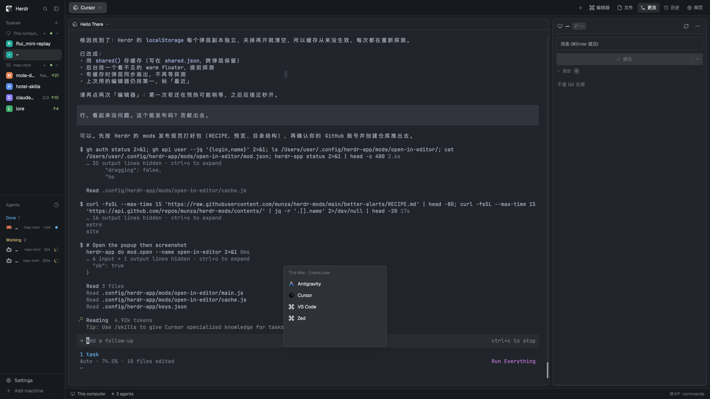

# Open in editor

Herdr Desktop mod: open the current space's project in Cursor, VS Code, Zed, and other editors — **on the machine that owns the space**.



## Install

Paste into an agent in Herdr:

> Read ~/.config/herdr-app/AGENTS.md, then add this mod: https://github.com/debug-null/herdr-open-in-editor

It runs `exec` on the space's machine (and `open -a` on macOS). It does not reach the network. Cache lives in Herdr `shared()` state.

### After copy

1. Merge `keys.json` (`cmd-shift-e` opens the popup), or ask before replacing a key you already use.
2. On a layout you own, add a warm floater so the first click is fast:

```json
{
  "id": "open-in-editor-warm",
  "content": { "mod": "open-in-editor", "props": { "warm": true } },
  "edge": "bottom",
  "align": "start"
}
```

3. Optional: clone your tabs mod and add a tab-bar button that calls  
   `openOverlay({ mod: "open-in-editor", kind: "popup", width: 300, height: 240 })`.

See [RECIPE.md](RECIPE.md) for the full brief.

## License

MIT
