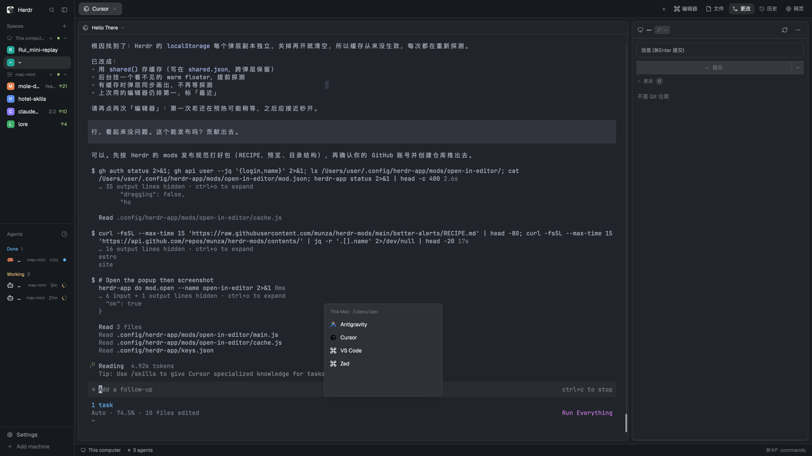

# Open in editor

A popup that opens the current Herdr space's project folder in a desktop editor on the **same machine** as that space. Local spaces open on this Mac; a space on `mac-mini` opens Cursor / VS Code / Zed there. Installed editors are probed once and cached in `shared()` so the menu opens instantly after the first warm-up. The last editor you used on that machine is sorted first and labelled `recent`.

## What you see

A popup list of editors found on the active space's machine (Cursor, VS Code, Zed, Antigravity, VS Code Insiders, Windsurf when present). The header shows `This Mac · /path` or `mac-mini · /path`. Empty floating warm copy draws nothing. Optional tab-bar button labelled with a code icon opens the same popup.

## How it behaves

- Folder: focused pane cwd in the active space's tabs, else another pane cwd, else the space folder; then `git rev-parse --show-toplevel` on that machine when possible.
- Probe: `command -v` and common `/Applications` / `$HOME/.local/bin` paths via `exec(..., { on: machine })`.
- Cache: `shared("open-in-editor")` stores editors per machine and folders per space for 30 minutes. `localStorage` is not used (each overlay copy has its own).
- Warm floater (`props.warm`): prefetches in the background and every 60s when the cache is stale.
- Click an editor: `bin [folder]` on that machine, else `open -a App folder`. Records last-used id for that machine.
- Shortcut from `keys.json`: `cmd-shift-e` → `mod.open:open-in-editor`.

## Built from

`mods/open-in-editor/`: `main.js`, `cache.js`, `mod.json` (`place: none`, popup overlay 300×240). Uses `exec`, `spaces`, `panes`, `shared` / `setShared`, `notify`, `openOverlay`/`mod.open`, `props`. Icons from Herdr's shipped `icons/`. Optional `keys.json` merge. Install a root floating block `{ "id": "open-in-editor-warm", "content": { "mod": "open-in-editor", "props": { "warm": true } }, "edge": "bottom", "align": "start" }` on a layout you own. Optional tab-bar button: clone `tabs` (or your tabs clone) and `openOverlay({ mod: "open-in-editor", kind: "popup", width: 300, height: 240 })`.

## Watch out

Shipped layouts and shipped `tabs` are read-only — clone before adding the warm floater or a tab-bar button. Cross-mod imports are forbidden, so keep probe/cache inside this mod. Remote Linux machines need editors on PATH; `open -a` is macOS-only (CLI bins still work). First open per machine can take a moment while probing; later opens should be instant while the cache is warm.

## Done when

- `herdr-app check ~/.config/herdr-app/mods/open-in-editor` passes.
- On a local space, the popup lists this Mac's editors and opens the git root (or cwd).
- On a remote Mac space, the header shows that machine name and opening launches the editor there.
- Second open within 30 minutes shows the list immediately; last-used editor is first with `recent`.
- `cmd-shift-e` opens the popup when `keys.json` was merged.
